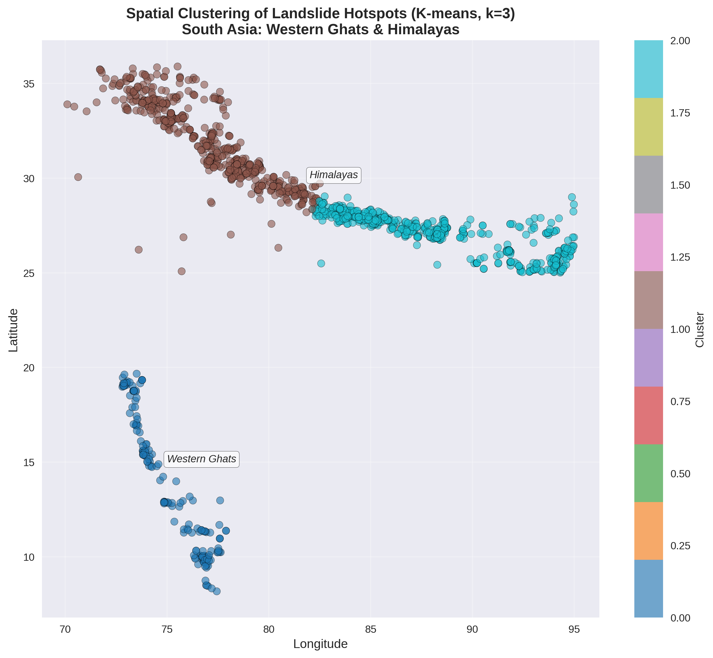
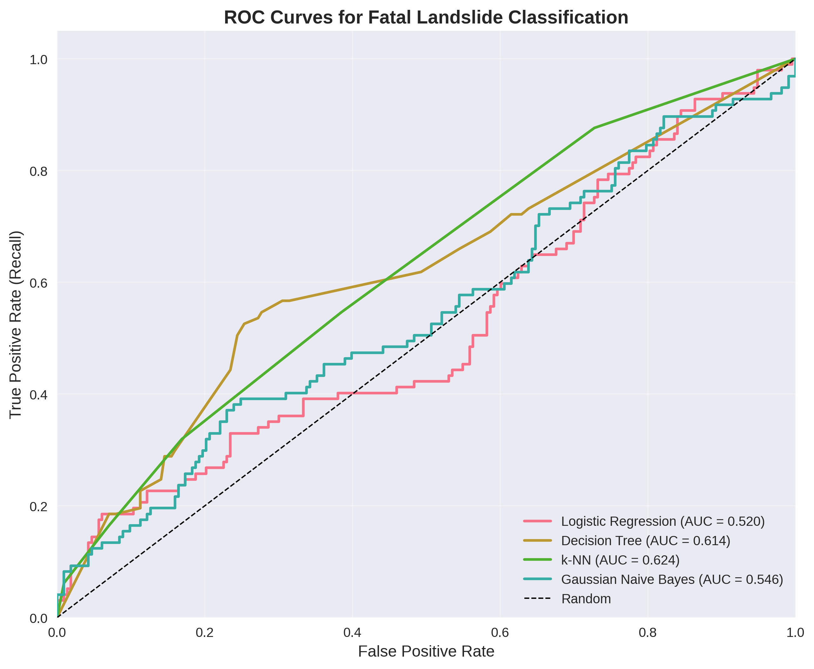
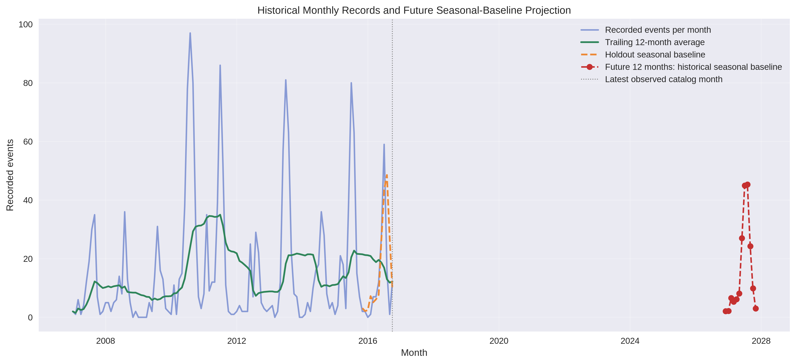
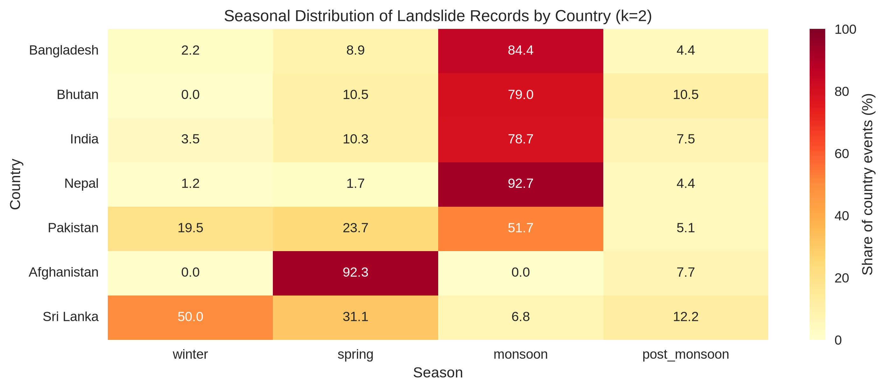

<div align="center">

# 🌧️ Machine Learning for Landslides

### A focused survey with an illustrative South Asia experiment

<p>
  
  
  
  
</p>

**A narrative survey of machine-learning approaches to landslide studies, paired with a reproducible experiment in event classification and coordinate clustering.**

[PDF report](Landslide_ML_Survey_Report.pdf) · [Survey article](LANDSLIDE_ML_SURVEY.md) · [Experiment](#-illustrative-experiment) · [Workflow](#-analysis-workflow) · [Quick start](#-quick-start) · [More docs](#-more-documentation)

</div>

---

## 🌍 Overview

This repository is organized as a review/survey article plus an illustrative analysis:

- The [survey article](LANDSLIDE_ML_SURVEY.md) reviews problem framing, common ML methods, evaluation, and validation pitfalls in landslide research.
- **Classification:** Logistic regression, decision tree, k-nearest neighbors, and Gaussian Naive Bayes classify recorded events by known fatality outcome.
- **Clustering:** K-means and agglomerative hierarchical clustering group the events' latitude/longitude coordinates.
- **Evaluation:** Fatal-class recall, F1-score, and ROC-AUC compare classifiers; silhouette score compares coordinate-cluster separation.

The illustrative experiment uses catalog records from **Afghanistan, Bangladesh, Bhutan, India, Nepal, Pakistan, and Sri Lanka**. Maldives is included in the map viewport but has no records in the filtered dataset.

> **Scope:** This is event-fatality classification and exploratory clustering, not a susceptibility map, landslide-occurrence forecast, or operational warning system.

## 📈 Outputs and visualizations

Run the analysis script to generate the figures, processed inventory, forecasts, and classifier metrics. The experiment's measured classifier and silhouette results are summarized below and documented in the report.

| South Asia coordinate clusters | Classifier ROC curves |
| --- | --- |
| [](landslide_spatial_clusters.png) | [](roc_curves.png) |

| Monthly records and future seasonal baseline | Country seasonal profiles |
| --- | --- |
| [](landslide_monthly_forecast.png) | [](landslide_seasonal_country_clusters.png) |

**Forecast caveat:** the local source catalog ends in September 2017 globally, and the South Asia subset ends in October 2016. The red future-period line is a historical calendar-month average, not a prediction of true future landslide incidence.

## ✨ What the project does

| Stage | Purpose |
| --- | --- |
| Load data | Read a local landslide CSV, or create synthetic sample data if it is unavailable |
| Filter events | Focus on South Asian countries and rainfall-related triggers without clipping locations to subregions |
| Prepare features | Derive time features and exclude records with unknown fatality labels from classification |
| Analyze time patterns | Aggregate monthly records, evaluate a seasonal baseline on a chronological holdout, and forecast 12 months |
| Cluster seasonal profiles | Group countries by normalized winter, spring, monsoon, and post-monsoon record shares |
| Explore coordinates | Compare K-means and agglomerative hierarchical clustering at three groups |
| Compare classifiers | Train four models and report fatal-class recall, F1, and ROC-AUC |
| Save results | Export processed records, forecasts, cluster profiles, and visualizations |

## 🧭 Analysis workflow

### 1. Data loading

The script looks for `Global_Landslide_Catalog_Export_rows.csv` in its configured local and relative paths. If no candidate can be loaded, it generates a synthetic dataset with example event dates, coordinates, and fatality labels.

The synthetic data makes it possible to exercise the pipeline without the source CSV. **Synthetic results are demonstrations only and must not be interpreted as findings about real landslide risk.**

#### Data coverage and currency

The local catalog currently contains 11,033 records dated **November 7, 1988 through September 28, 2017**. The South Asia rainfall-triggered subset used in the experiment ends in **October 2016**.

The [NASA Global Landslide Catalog export page](https://catalog.data.gov/dataset/global-landslide-catalog-export) was last updated as a dataset listing in 2025, but its description identifies the export as a historical catalog snapshot rather than live monitoring data.

### 2. Geographic and trigger filtering

The analysis keeps records from Afghanistan, Bangladesh, Bhutan, India, Maldives, Nepal, Pakistan, and Sri Lanka, then filters for rainfall-related trigger descriptions. It does not filter records to a narrower subregion within countries.

The spatial plot displays the full South Asia viewport (60°–100° E, 0°–40° N). These are display limits rather than event filters. If no rainfall-triggered events are present, the script falls back to a synthetic sample.

### 3. Cleaning and feature engineering

The script drops rows without usable coordinates, retains unknown fatality counts as missing, and marks missing trigger values as `unknown`. Records without a known fatality count are excluded from the supervised classification step.

- `fatal_class = 1` when the reported fatality count is greater than zero
- `fatal_class = 0` when the reported fatality count is zero

Dates are used to derive month, year, and a broad season category (`winter`, `spring`, `monsoon`, or `post_monsoon`). For classification, numeric features are imputed and scaled; categorical features are encoded for model input.

### 4. Monthly trends and future-count projection

The script counts dated records by month, filling gaps between the first and last recorded months with zero counts. It evaluates a calendar-month seasonal-average baseline against the final 12 months of observed data and then projects one year forward.

The output describes **catalog records**, not complete landslide incidence. Reporting coverage may vary over time, and a month with no records is not proof that no landslide occurred. The CSV includes the forecast period and method label for transparency.

### 5. Seasonal clustering of countries

For countries with at least 12 dated records, the script converts seasonal event counts into within-country proportions and applies K-means to the four-season profiles. It compares eligible cluster compositions against a distance-based baseline.

### 6. Spatial clustering

K-means and agglomerative hierarchical clustering are applied to event latitude and longitude across the selected South Asian countries, using **three clusters** for comparison. The longitude/latitude coordinates are treated as descriptive features, not as ground-truth hazard regions.

The clusters are **descriptive groupings of recorded coordinates**, not validated hazard zones or predictions of future events.

### 7. Fatality classification

The script uses a stratified train/test split and compares:

- Logistic Regression
- Decision Tree
- k-Nearest Neighbors (k-NN)
- Gaussian Naive Bayes

Reported metrics include accuracy, fatal-class precision, fatal-class recall, fatal-class F1-score, ROC-AUC, and a confusion matrix. Recall is highlighted because missed fatal events are important to identify in sparse, noisy event catalogs.

### 8. Evaluation and visualization

The pipeline prints model-level classification reports and a comparison table, then saves temporal, seasonal, and spatial visualizations plus ROC curves. It also exports the cleaned data, monthly forecasts, and seasonal country profiles to CSV.

## 📄 Illustrative experiment

The current catalog run retains **1,845** South Asian rainfall-triggered event records. Fatality counts are unknown for 345 records, so the classification uses the remaining **1,500 known labels** and evaluates them on a random 80/20 split.

| Classifier | Fatal recall | Fatal F1 | ROC-AUC |
| --- | ---: | ---: | ---: |
| Logistic regression | 0.4750 | 0.5044 | 0.6094 |
| Decision tree | **0.5333** | **0.5289** | 0.6413 |
| k-NN | 0.4667 | 0.5185 | **0.6775** |
| Gaussian Naive Bayes | 0.1500 | 0.2400 | 0.6207 |

With three coordinate clusters, the silhouette scores are **0.6070** for K-means and **0.5728** for agglomerative clustering. These results describe one random split and one coordinate representation, not a definitive map of landslide risk.

The [survey article](LANDSLIDE_ML_SURVEY.md) gives the complete experiment protocol, results, interpretation, limitations, and references.

## 🧮 Mathematical methods and calculations

This section gives a simple explanation of how the analysis makes groups and checks its predictions.

### 1. Fatal or non-fatal?

The script turns each event's fatality count into one of two labels:

```text
fatal_class = 1, if fatality_count > 0
fatal_class = 0, if fatality_count = 0
```

The model predicts the category, not the number of people affected.

**Example:** An event with 3 reported fatalities gets label `1`; an event with 0 gets label `0`.

### 2. Preparing the input data

Before training, the pipeline prepares the input features:

- Missing numeric values are filled with the median from the training data.
- Numeric features such as latitude, longitude, and month are standardized so their scales are more comparable.
- Text categories such as season and trigger are converted into indicator columns (one-hot encoding).

Standardization follows this idea:

```text
z = (x - mean) / standard deviation
```

The pipeline learns these preparation values from training data, then applies them to test data.

**Example:** If a training-set feature has an average of 10 and a standard deviation of 2, then for `x = 14`:

```text
z = (14 - 10) / 2 = 2
```

### 3. Grouping locations with K-means

K-means groups events by their latitude and longitude. It starts with cluster centers, assigns each event to its nearest center, and moves each center to the average location of its assigned events. This process repeats until the groups stabilize.

The center of a cluster is the average of its event coordinates:

```text
center latitude  = sum of latitudes / number of events
center longitude = sum of longitudes / number of events
```

The spatial analysis uses three clusters to provide a consistent South Asia-wide view. The silhouette score describes how well-separated the chosen clusters are; it does not establish landslide risk.

**Simple example:** If two events are at `(15, 75)` and `(16, 76)`, their average center is:

```text
latitude  = (15 + 16) / 2 = 15.5
longitude = (75 + 76) / 2 = 75.5
center    = (15.5, 75.5)
```

### 4. Checking cluster quality: silhouette score

The silhouette score checks whether events are closer to their own group than to other groups. It ranges from **-1 to 1**:

```text
silhouette = (distance to other group - distance to own group)
             / larger of those two distances
```

- Near **1**: groups are well separated.
- Near **0**: groups overlap.
- Below **0**: some events may fit better in another group.

This score measures how clearly the coordinates form groups. It does not measure landslide danger.

**Example:** A score of `0.72` suggests fairly distinct groups; a score of `0.05` suggests the groups overlap substantially.

> **Location note:** The script measures distances directly in latitude/longitude degrees. These are not exact ground distances, so treat the clusters as exploratory.

### 5. Training and testing the models

The data is split into:

- **80% training data** — used to teach the models.
- **20% test data** — used to check their predictions on records they did not train on.

The split is random but keeps roughly the same fatal/non-fatal proportions in each part. It is not a test of future events or entirely new locations.

**Example:** With 1,000 records, an 80/20 split gives about 800 training records and 200 test records.

The four models learn in different ways:

- **Logistic Regression** estimates the chance that an event is fatal.
- **Decision Tree** makes predictions through a sequence of feature-based decisions.
- **k-Nearest Neighbors** looks at the five most similar training examples and uses their labels.
- **Gaussian Naive Bayes** estimates class probabilities using a simplifying assumption that features are independent.

**Example:** If a classifier assigns an event a fatal probability of `0.80`, its default classification threshold of `0.50` labels it fatal. This probability is a model estimate, not a guarantee.

### 6. Understanding the prediction scores

For the fatal class, predictions can be grouped like this:

| | Model says non-fatal | Model says fatal |
| --- | ---: | ---: |
| **Actually non-fatal** | Correctly rejected | False alarm |
| **Actually fatal** | Missed fatal event | Correctly detected |

The script summarizes these results with:

- **Accuracy:** How often the model is correct overall.
- **Precision:** Of the events called fatal, how many were actually fatal?
- **Recall:** Of the actually fatal events, how many did the model find?
- **F1-score:** A combined score for precision and recall.

```text
accuracy  = (correct fatal + correct non-fatal) / all events
precision = correct fatal / (correct fatal + false alarms)
recall    = correct fatal / (correct fatal + missed fatal)
F1        = 2 * precision * recall / (precision + recall)
```

For example, suppose the model correctly detects **18** fatal events, misses **2**, raises **10** false alarms, and correctly identifies **70** non-fatal events:

```text
Accuracy  = (18 + 70) / 100       = 88%
Precision = 18 / (18 + 10)        ≈ 64%
Recall    = 18 / (18 + 2)         = 90%
F1        = 2 * 0.64 * 0.90 / (0.64 + 0.90) ≈ 75%
```

In this example, the model finds most fatal events (high recall), but some events it flags are false alarms (lower precision). These numbers are only an example, not results from this project.

### 7. ROC curve and ROC-AUC

The ROC curve compares how many fatal events a model detects against how many non-fatal events it incorrectly flags, as the probability cutoff changes. **ROC-AUC** summarizes this comparison in one number, from **0.5** (random) to **1.0** (perfect separation).

```text
true positive rate = correctly detected fatal / all actually fatal
false positive rate = false alarms / all actually non-fatal
```

- **1.0** means the model separates the two classes very well.
- **0.5** is about the same as random ranking.

ROC-AUC does not choose a cutoff for real-world decisions. It is a comparison measure, not proof that a model is safe or reliable.

**Example:** An ROC-AUC of `0.80` means that, for a randomly selected fatal and non-fatal event, the model ranks the fatal event higher about 80% of the time (subject to ties). It does not mean 80% of future events will be accurately predicted.

## 📊 Generated outputs

Running the script from the project directory creates or updates:

| Output | Description |
| --- | --- |
| `Landslide_ML_Survey_Report.pdf` | Illustrated survey and experiment report, formatted as a two-column research article |
| `landslide_monthly_forecast.png` | Monthly catalog counts, holdout baseline, and historical seasonal-average projection for future dates |
| `landslide_monthly_forecast.csv` | Future 12-month historical seasonal-mean projections, with latest data month and method |
| `landslide_seasonal_country_clusters.png` | Heatmap of country-level seasonal event shares |
| `country_seasonal_clusters.csv` | Seasonal shares, event counts, and cluster labels by country |
| `landslide_spatial_clusters.png` | Scatter plot of coordinate clusters and centers |
| `roc_curves.png` | ROC curves comparing classifier discrimination |
| `classification_metrics.csv` | Numeric accuracy, precision, recall, F1, and ROC-AUC for each classifier |
| `processed_landslide_data.csv` | Filtered and processed records, including derived fields |

Outputs are written relative to the current working directory.

## 🚀 Quick start

### Requirements

- Python 3
- pandas
- NumPy
- scikit-learn
- Matplotlib
- Seaborn

### Install dependencies

```bash
python -m pip install pandas numpy scikit-learn matplotlib seaborn
```

### Run the analysis

From the project directory:

```bash
python run_landslide_analysis.py
```

To use the real-data path, place `Global_Landslide_Catalog_Export_rows.csv` in the project directory. Check the console output to confirm whether the CSV or synthetic fallback was used.

## 🗂️ Project files

```text
.
├── run_landslide_analysis.py          # Analysis pipeline
├── Global_Landslide_Catalog_Export_rows.csv  # Optional input dataset
├── LANDSLIDE_ML_SURVEY.md             # Focused ML survey and illustrative experiment
├── Landslide_ML_Survey_Report.pdf     # Illustrated, print-ready research report
├── processed_landslide_data.csv       # Generated processed data
├── landslide_monthly_forecast.csv     # Generated seasonal-baseline forecast
├── country_seasonal_clusters.csv      # Generated country seasonal profiles
├── classification_metrics.csv        # Generated classifier metrics
├── landslide_monthly_forecast.png     # Generated time-series visualization
├── landslide_seasonal_country_clusters.png  # Generated seasonal-cluster heatmap
├── landslide_spatial_clusters.png     # Generated clustering plot
└── roc_curves.png                     # Generated ROC plot
```

Generated files may not exist until the script has run.

## 🧰 Tools and methods

- **Data handling:** pandas, NumPy
- **Modeling:** seasonal-average time-series baseline, scikit-learn pipelines, K-means, Logistic Regression, Decision Tree, k-NN, Gaussian Naive Bayes
- **Visualization:** Matplotlib, Seaborn
- **Evaluation:** silhouette score, precision, recall, F1-score, ROC-AUC, confusion matrix

## ⚠️ Important limitations

- Missing fatality counts are treated as unknown and excluded from supervised classification.
- The synthetic fallback is generated data and cannot support conclusions about actual events.
- Historical catalog coverage is incomplete and uneven; the monthly projection extrapolates record counts, not true landslide incidence. The local source CSV ends in September 2017 globally, and the South Asia rainfall subset ends in October 2016.
- Months with zero catalog entries are treated as zero in the time series, which can reflect missing reporting rather than no events.
- Seasonal country clusters require at least 12 dated records per country and should be treated as exploratory, especially for smaller samples.
- Geographic bounds and trigger matching are approximate and may omit relevant events or include unrelated ones.
- The classifier uses a random stratified split, not a time-based or location-based validation. Performance may therefore overstate how well it generalizes to future events or new regions.
- Historical event records and available features may be incomplete, biased, or inconsistent.
- Reported fatality counts and trigger metadata are frequently incomplete, inconsistently coded, or under-reported across sources, so the fatal/non-fatal target may carry measurement error and understate true human impacts.
- Clustering results depend on the input records and chosen method; they do not establish causal factors or forecast future landslides.
- This project has not been established as a safety-critical decision tool.

## 🌱 Research alignment

The project explores themes connected to:

- **UN SDG 11:** Sustainable Cities and Communities
- **UN SDG 15:** Life on Land

## 📚 More documentation

See [`LANDSLIDE_ML_SURVEY.md`](LANDSLIDE_ML_SURVEY.md) for the survey discussion, experiment protocol, results, limitations, and references.

---

<div align="center">

**For research and educational exploration of landslide data in South Asia.**

</div>
